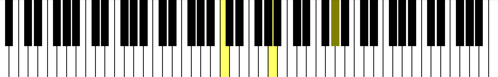
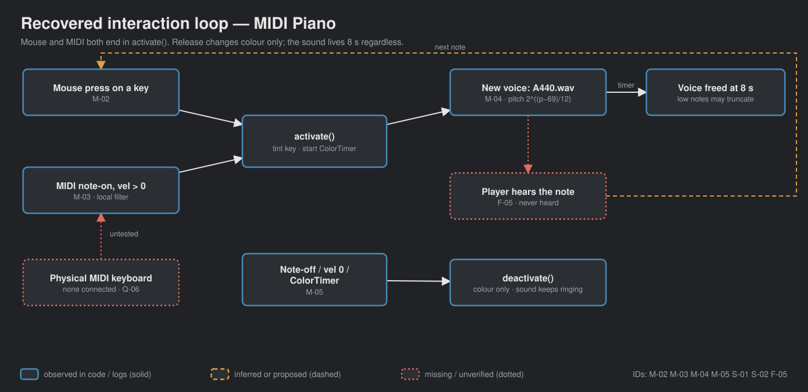
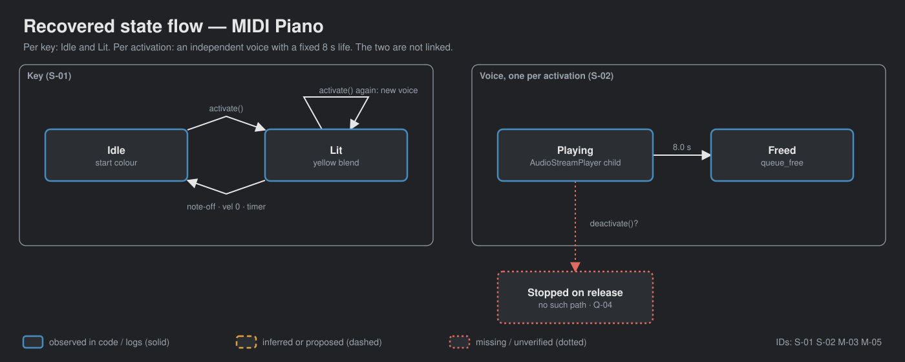

# walker-audio-midi-piano — Game Design Document (recovered)

| | |
|---|---|
| Version | 0.1.0-recovered |
| Date | 2026-09-27 |
| Author | Recovered by Zelda (/gdd reverse --path godot silent), for Nik Bear Brown |
| Mode | recovered, silent |
| Revision | 1 |
| Gates | vision ○ · systems ○ · world ○ · scope ○ — gate — unsigned at time of writing |
| Source | local copy of the Godot demo `audio/midi_piano`, commit a3b5c113 (Godot Engine contributors, MIT), with local MIDI-filtering edits |
| What this is | a **tech demo** of MIDI input, not a game; the closest of this batch to a playable instrument |

Provenance tags: `[OBSERVED path:line]` the code or a local log shows this · `[INFERRED]` the code strongly implies this, evidence stated · `[MISSING]` nothing in the folder can tell us this. Paths are relative to the folder root. A recovered GDD describes what exists; it approves none of it. In the diagrams, observed elements are solid, inferred or proposed ones dashed, missing or unverified ones dotted.

*`[OBSERVED godot/screenshots/piano-pressed.png]` Screenshot shipped with the upstream demo (a pressed key highlighted), not a local Walker capture. No visible window was opened locally `[OBSERVED README.md]`.*

## 1. Vision summary

**What the code is.** An 88-key on-screen piano (MIDI pitches 21–108) built at runtime from white- and black-key scenes. Keys light up and play a single A440 sample pitch-shifted per key, triggered by mouse clicks or MIDI note messages `[OBSERVED godot/piano.gd:9-51; godot/piano_keys/piano_key.gd:10-29]`. The upstream README: a piano "that can be controlled by a MIDI device" `[OBSERVED godot/README.md]`.

**Logline.** Plug in a keyboard, see and hear the note. `[INFERRED]`

**Audience.** Godot developers handling `InputEventMIDI` `[INFERRED godot/README.md]`. Walker audience `[MISSING]`.

**Why it exists in Walker.** Two native-4K Liam films and human review are planned `[OBSERVED README.md]`. Purpose beyond that `[MISSING]`.

**Biggest unresolved question.** Is the local MIDI fix part of the Walker version, and does the film show upstream behavior or the fixed one? Q-01.

## 2. Design pillars

None on record `[MISSING]`. Candidates `[INFERRED]`: P-01 one sample, 88 pitches (`pitch_scale = 2^((pitch−69)/12)`, `piano_key.gd:12-13`); P-02 every input path ends in the same `activate()` (mouse and MIDI both call it, `piano_key_color.gd:6-8`, `piano.gd:48-49`).

## 3. Core loop

**Micro.** Press a key (mouse or MIDI note-on) → key tints yellow, a new AudioStreamPlayer plays A440.wav at the key's pitch → colour resets on note-off, zero-velocity note-on, or after the ColorTimer → the voice frees itself after 8 s `[OBSERVED piano.gd:35-51; piano_key.gd:16-29]`. Playing a melody is the loop `[INFERRED]`; nobody has played one or heard it `[OBSERVED README.md]`.

**Meso / macro.** None `[OBSERVED]`.

**Loop honesty test.** A keyboard instrument. It has real skill expression if a human plays it, but no goal, score or end. Not a game `[INFERRED]`.

## 4. Player Experience Goals

None recorded `[MISSING]`. Candidate PX-01 `[INFERRED]`: pressing a physical key produces the matching on-screen key and pitch without noticeable delay. Untested (no MIDI hardware reported, `OS.get_connected_midi_inputs()` returned `[]`, `mouse-input-20260927.log`).

## 5. Mechanics

### M-01 Build the keyboard `[OBSERVED piano.gd:20-32,54-89]`
For pitches 21–108, instantiate a white or black key; add placeholders so black keys align. Opens MIDI inputs. START_KEY must not be a sharp (assert, line 21).

### M-02 Mouse press `[OBSERVED piano_keys/piano_key_color.gd:6-8]`
Any left mouse press on a key's ColorRect calls `activate()`. Mouse release does nothing `[OBSERVED: handler checks pressed only]`.

### M-03 MIDI handling (local edit) `[OBSERVED piano.gd:35-51]`
Ignores messages other than note-on/note-off; ignores pitches outside 21–108; note-on with velocity > 0 activates; note-off or zero-velocity note-on deactivates. Prints each handled event (lines 92-101). Upstream treated every non-note-on message as deactivate and did not distinguish zero velocity; the local edit was made after reproducing 3 of 7 failures `[OBSERVED FRICTIONAL.md 14:36; midi-baseline-20260927.log]`.

### M-04 Voice `[OBSERVED piano_keys/piano_key.gd:16-25]`
`activate()` tints the key, creates a new AudioStreamPlayer with `A440.wav` at the key's `pitch_scale`, starts the ColorTimer (one-shot, default wait time `[INFERRED 1 s engine default; test observed colour restored by 1.2 s]`), and frees the player after 8.0 s.

### M-05 Release `[OBSERVED piano_key.gd:28-29]`
`deactivate()` only restores colour. It does not stop the sound; no sustain, velocity loudness or channel ownership exists `[OBSERVED FRICTIONAL.md 14:36]`.

Tuning values (source, not approved design): 88 keys 21–108; voice lifetime 8.0 s; A440 reference at pitch 69; highlight = average of yellow and key colour; viewport 1280×200 `[OBSERVED piano.gd:9-10; piano_key.gd:13,17,24; project.godot:25-26]`.

Edge cases: the sample is 8.010884 s long but the voice is freed at 8 s regardless of pitch, so lower notes (played slower) may be truncated `[OBSERVED FRICTIONAL.md 15:06; ASSET-PROVENANCE.md]`; repeated presses stack voices without limit `[INFERRED piano_key.gd:18-19]`.

## 6. Systems

### S-01 Key state `[OBSERVED]`
Idle ↔ Lit. Lit on `activate()`; Idle on `deactivate()` (note-off, zero-velocity note-on, or ColorTimer timeout, `white_piano_key.tscn:26`).

### S-02 Voice lifetime `[OBSERVED piano_key.gd:18-25]`
Each activation spawns an independent voice that lives 8 s, unaffected by key state.

### S-03 MIDI input `[OBSERVED piano.gd:29-32]`
`OS.open_midi_inputs()` at ready; connected inputs printed if any. The local test closes inputs after completion.

## 7. Progression

None `[OBSERVED]`.

## 8. World

N/A. A black ColorRect backdrop with two HBox rows of keys `[OBSERVED piano.tscn:5-18]`.

## 9. Narrative

N/A.

## 10. Characters

N/A.

## 11. Features and priority

| ID | Feature | Tag | Status |
|---|---|---|---|
| F-01 | 88-key layout | CORE `[INFERRED]` | 88 keys / 52 white verified `[OBSERVED mouse-input-20260927.log]` |
| F-02 | Mouse play | CORE `[INFERRED]` | keys 69/70 highlight and start voices `[OBSERVED log]` |
| F-03 | MIDI play (with local filtering) | CORE `[INFERRED]` | synthetic parser 7/7, boundaries 13/13 `[OBSERVED midi-after, midi-boundaries logs]` |
| F-04 | Pitch-shifted single sample | CORE `[INFERRED]` | A220/440/880 ratios 0.5/1/2 verified `[OBSERVED log]` |
| F-05 | Heard pitch and physical MIDI | CORE for the films `[INFERRED]` | not verified `[OBSERVED README.md]` |
| F-06 | Note-off muting, sustain, velocity | — | absent `[OBSERVED FRICTIONAL.md]` |

**CORE percentage.** No tags on record `[MISSING]`; inferred 5 of 6 = 83%. Recorded (Q-03).

## 12. Out of scope

Nothing written `[MISSING]`. Observed absences: MIDI output (upstream README: "MIDI output is not yet supported in Godot"), sustain pedal, velocity-sensitive loudness, voice limit, keyboard (computer) input.

## 13. Technical

Godot 4.7 features, GL Compatibility, viewport 1280×200 `[OBSERVED project.godot:16,25-26,30-31]`; runs logged with 4.7.2 headless/Dummy `[OBSERVED logs]`. No `[input]` section; MIDI arrives as `InputEventMIDI` in `_input`. Class `PianoKey` (`piano_key.gd:1`). Scenes: `piano.tscn`, `piano_keys/white_piano_key.tscn`, `piano_keys/black_piano_key.tscn`; ColorTimer `timeout` → `deactivate` in both key scenes. Assets: `piano_keys/A440.wav` (stereo PCM 16-bit 44.1 kHz, 8.010884 s, SHA256 recorded in ASSET-PROVENANCE.md; no WAV-specific license found), icon, upstream screenshot. Local tests: `godot/test_piano.gd` (12 mouse/state checks), `godot/test_midi.gd` (synthetic `InputEventMIDI` via `Input.parse_input_event`).

## 14. Risks

| ID | Risk | Evidence |
|---|---|---|
| R-01 | Local MIDI edit breaks "copy of upstream" framing in films | `[OBSERVED README.md "Production edits"]` |
| R-02 | Low notes truncated by the fixed 8 s voice lifetime | `[OBSERVED FRICTIONAL.md 15:06]` |
| R-03 | Synthetic parser tests read as hardware verification | `[OBSERVED FRICTIONAL.md]` |
| R-04 | Unbounded voice stacking under fast repeated input | `[INFERRED piano_key.gd:18-19]` |
| R-05 | A440.wav rights not independently established | `[OBSERVED ASSET-PROVENANCE.md]` |

## 15. Open questions

In `design/decisions.md`: Q-01 upstream vs fixed behavior in films; Q-02 audience and purpose; Q-03 priorities; Q-04 note-off muting / sustain / velocity; Q-05 low-note truncation; Q-06 physical MIDI test setup; Q-07 A440.wav provenance.

## 16. Tests

| ID | Script / log | Checks | Result |
|---|---|---|---|
| T-01 | `godot/test_piano.gd` → `mouse-input-20260927.log` | 88 keys; 52 white; ratios A220/440/880; mouse highlights + voice for 69/70; timer restores colour; voices cleaned up after 8 s | 12/12 |
| T-02 | same → `mouse-regression-20260927.log` | same, after the MIDI edit | 12/12 |
| T-03 | `godot/test_midi.gd` → `midi-before-20260927.log` | harness parse error (wrong constant) | not a result |
| T-04 | `test_midi.gd` → `midi-baseline-20260927.log` | upstream behavior | 3 of 7 fail |
| T-05 | `test_midi.gd` → `midi-after-20260927.log` | note-on, aftertouch ignored, zero-velocity release, no zero-velocity voice, note-off, out-of-range ignored, cleanup | 7/7 |
| T-06 | `test_midi.gd` → `midi-boundaries-20260927.log` | T-05 plus pitch 21 and 108 activate/release, controller ignored | 13/13 |
| T-07 | `import-20260927.log`, `runtime-20260927.log` | import; 120-frame startup | clean |

Proposed `[INFERRED from FRICTIONAL.md]`: physical MIDI device, heard pitch, low-note truncation listening test. None exist.

## Zelda's notes (silent mode; what I would have said out loud)

| Mode | Rating | Note |
|---|---|---|
| Ghost Center | PRESENT | Expected. |
| Mechanic Mirage | PRESENT | No experience goals. |
| Implementation Void | PARTIAL | MIDI edge cases are now tested; voice limits and release are not designed. |
| Priority Inflation | PRESENT | 83% by inference, but on a six-row list. |
| Novelist's Trap | ABSENT | |
| Completeness Fallacy | PRESENT | Whether the fix belongs in the Walker version is undecided. |
| Stagnant Artifact | ABSENT | FRICTIONAL.md is dated and ordered. |

1. **This one has a player.** Unlike its siblings, a person can actually perform on it. That makes latency and release behavior design questions, not just test items.
2. **Release does not release.** Lifting a key only restores its colour; the note rings for 8 s. On a real keyboard that will feel wrong immediately (Q-04).
3. **First fix:** Q-01. The folder already diverges from upstream; say which version the films show.
